# Evidências e Adaptação do Chemotion - Testes de Rede

Esta pasta reúne a documentação, capturas de tela e análises da adaptação do ELN **Chemotion** para o registro de experimentos e simulações de Redes de Computadores no âmbito do TCC.

---

## 📌 Características e Limitações da Plataforma

* **Gestão de Usuários e Permissões:** Possui dois papéis principais de usuário (**Admin** e **Person**). A hierarquia é direta (Admin → Usuário), com suporte a organização por grupos.
* **Compartilhamento de Coleções:** É possível compartilhar coleções (*Collections*) com grupos ou usuários específicos, atribuindo permissões nominais e funcionais (Read, Write, Share, Pass ownership ou Import Elements).
* **Estrutura de Registro Adaptada:** Por ser voltado para química, a maioria das abas nativas exige metadados químicos obrigatórios para salvar formulários. A adaptação para Redes de Computadores foi realizada concentrando as informações nas abas **`Research plan`**, **`References`** e **`Analyses`**.
* **Integrações:** Suporta integração com Jupyter Notebook via API Python oficial e disponibiliza recursos de agenda/calendário.

---

## 📸 Evidências do Ambiente e Funcionalidades

### 1. Autenticação e Painéis Principais (Dashboards)

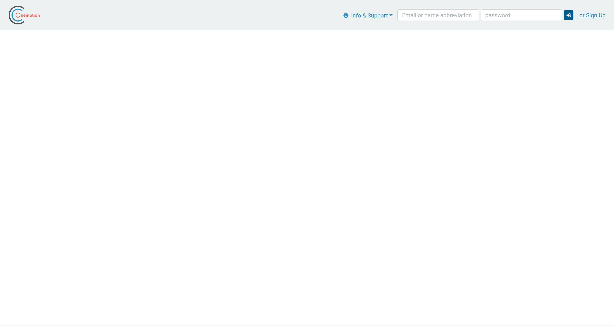
*Figura 1: Tela de autenticação e acesso à plataforma Chemotion.*

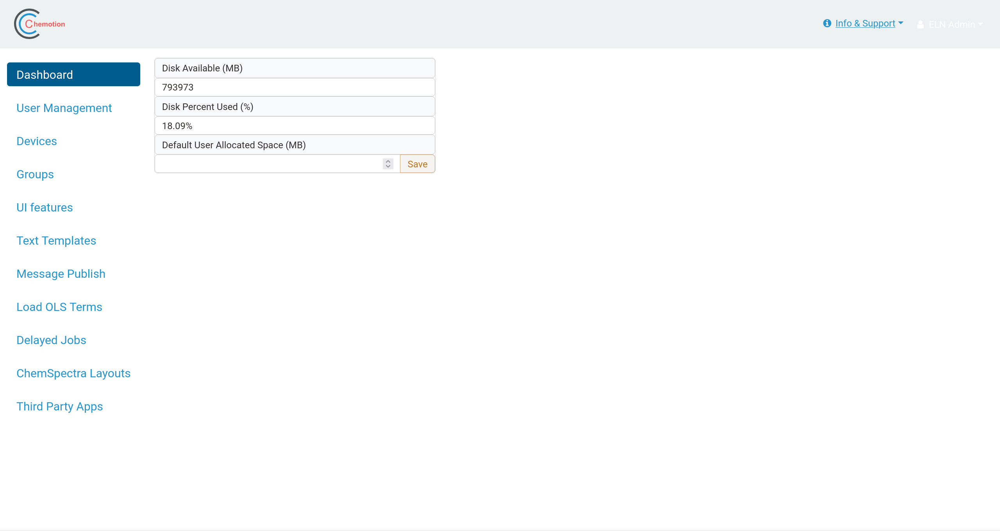
*Figura 2: Painel administrativo do Chemotion, exibindo métricas de armazenamento em disco e configurações do sistema.*

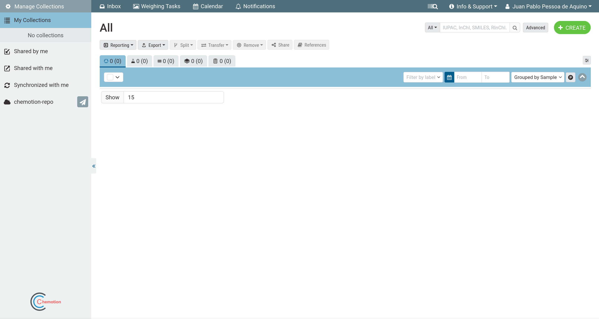
*Figura 3: Interface principal do usuário comum, listando coleções e opções de navegação.*

---

### 2. Gestão de Usuários e Grupos

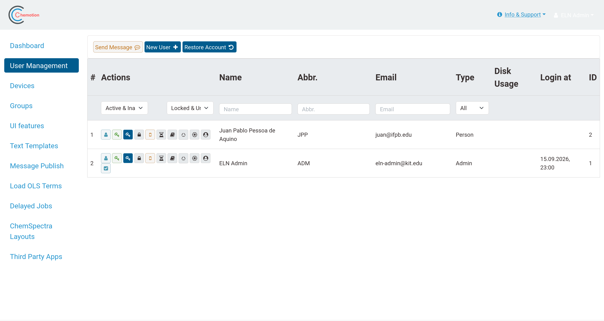
*Figura 4: Painel de gestão de usuários listando perfis cadastrados e tipos de conta (Person e Admin).*

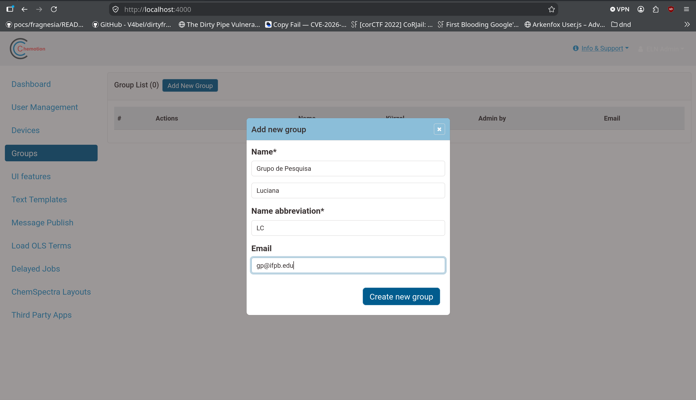
*Figura 5: Formulário de criação de grupo de pesquisa ("Grupo de Pesquisa Luciana").*

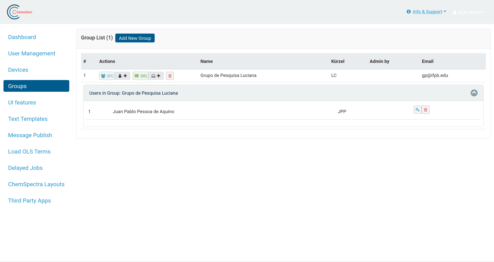
*Figura 6: Painel de gerenciamento de grupos com associados vinculados (ex: usuário Juan Pablo).*

---

### 3. Coleções, Atribuição de Permissões e Referências

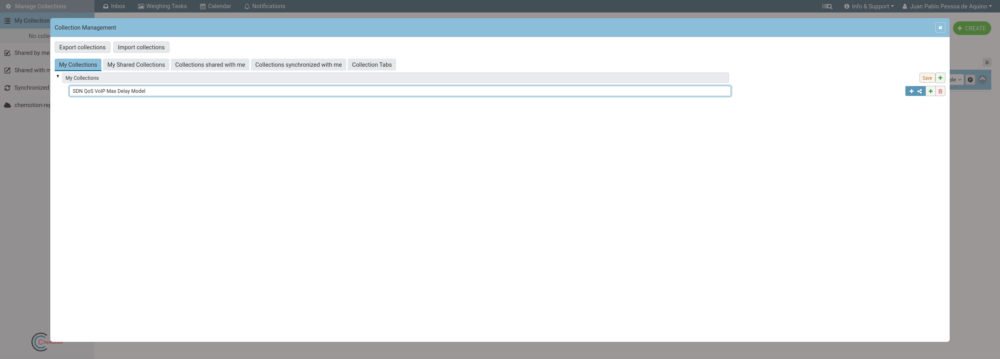
*Figura 7: Gerenciamento de Coleção para o experimento "SDN QoS VoIP Max Delay Model".*

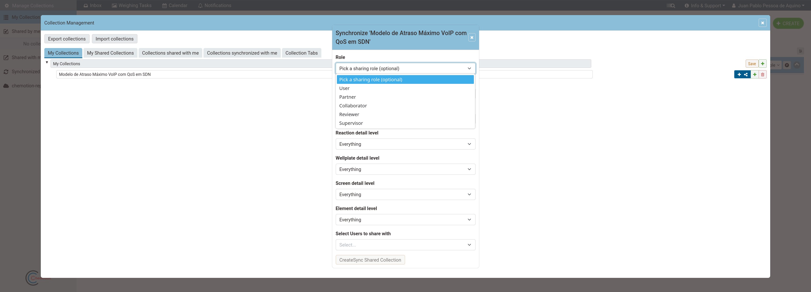
*Figura 8: Configuração de sincronização e papéis de compartilhamento (User, Partner, Collaborator, Reviewer, Supervisor).*

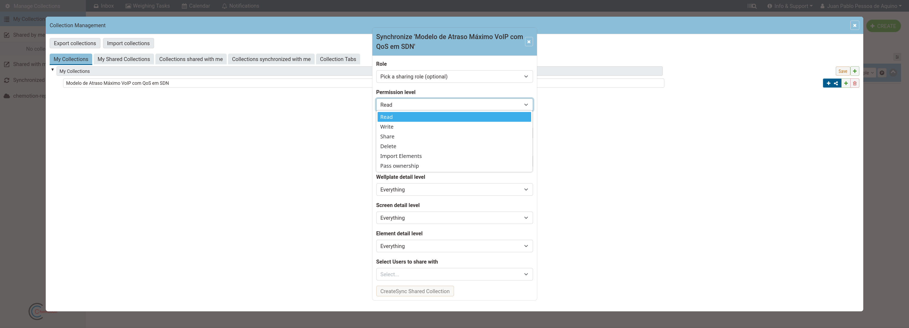
*Figura 9: Definição de níveis de permissão em coleções compartilhadas (Read, Write, Share, Delete, Import Elements).*

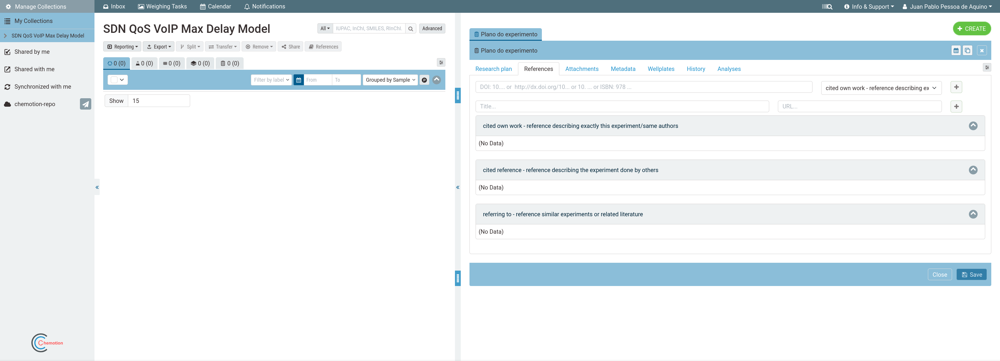
*Figura 10: Aba "References" para inclusão de trabalhos citados, bibliografia e artigos de apoio.*

---

### 4. Execução, Análises e Histórico do Experimento

*Figura 11: Editor de texto na aba "Research Plan" detalhando o ambiente de testbed e procedimentos experimentais.*

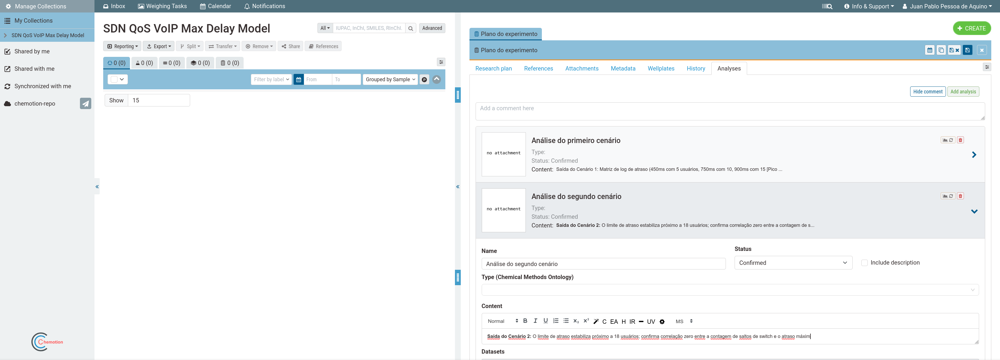
*Figura 12: Aba "Analyses" contendo o detalhamento dos cenários de testes de atraso.*

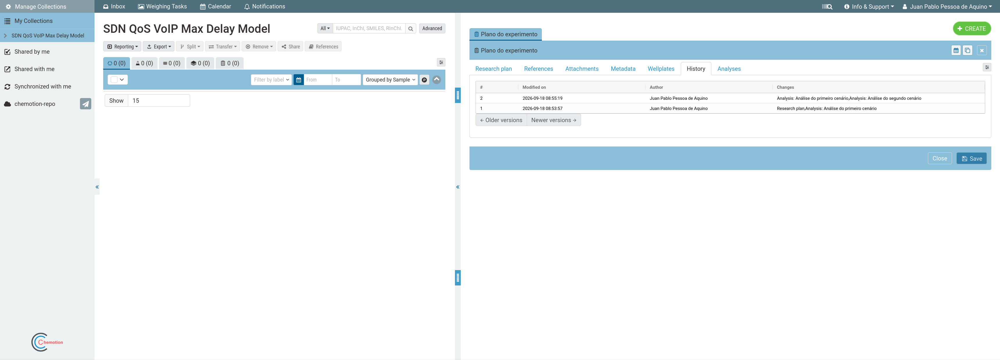
*Figura 13: Registro cronológico de alterações e histórico de versões do plano de experimento.*

---

### 5. Recursos Adicionais

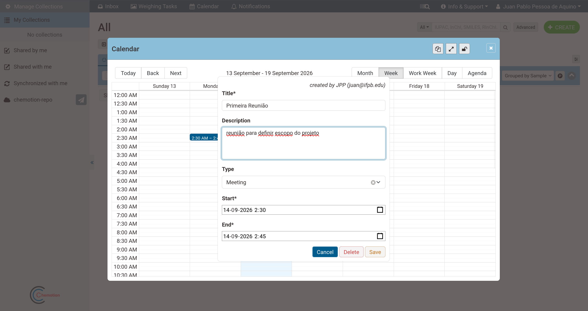
*Figura 14: Recurso de calendário integrado para agendamento de reuniões e etapas do projeto.*

---

## 📊 Resumo do Experimento Registrado

* **Experimento:** Modelo de Atraso Máximo VoIP com QoS em SDN
* **Aba Utilizada:** `Research plan` > `Analyses`
* **Resultados Registrados:**
  * **Cenário 1:** Matriz de log de atraso (450 ms com 5 usuários; 750 ms com 10 usuários; 900 ms com 15 usuários).
  * **Cenário 2:** O limite de atraso estabiliza próximo a 18 usuários, confirmando correlação zero entre a contagem de saltos de switch e o atraso máximo.
* **Status:** Validação concluída.
