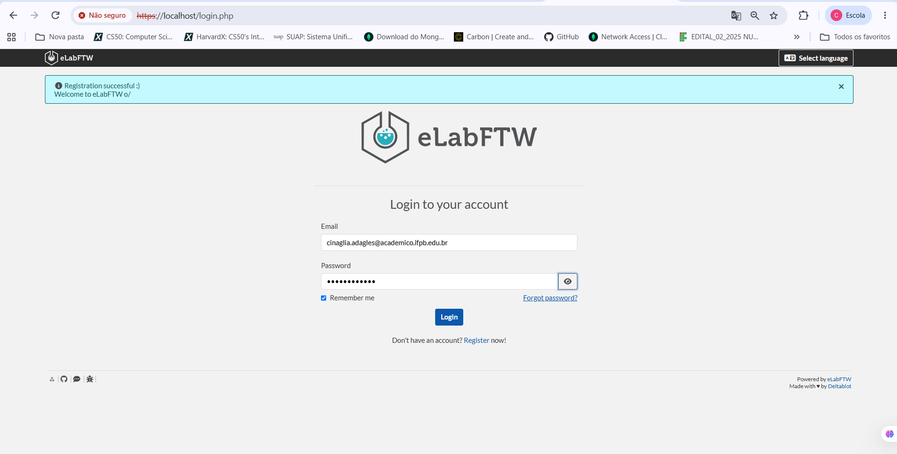
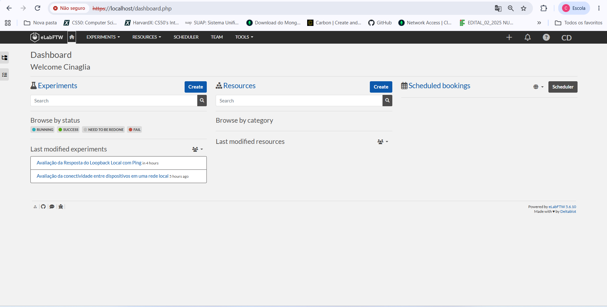
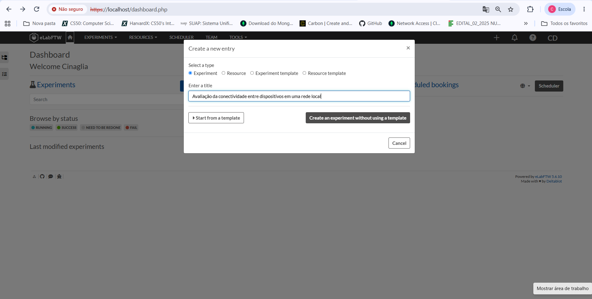
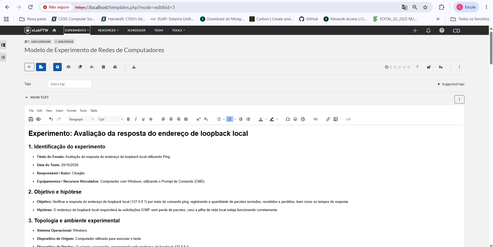
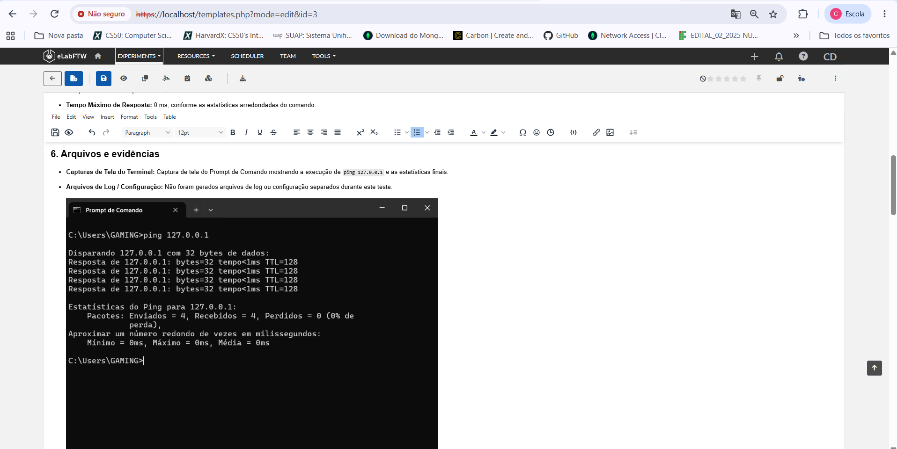
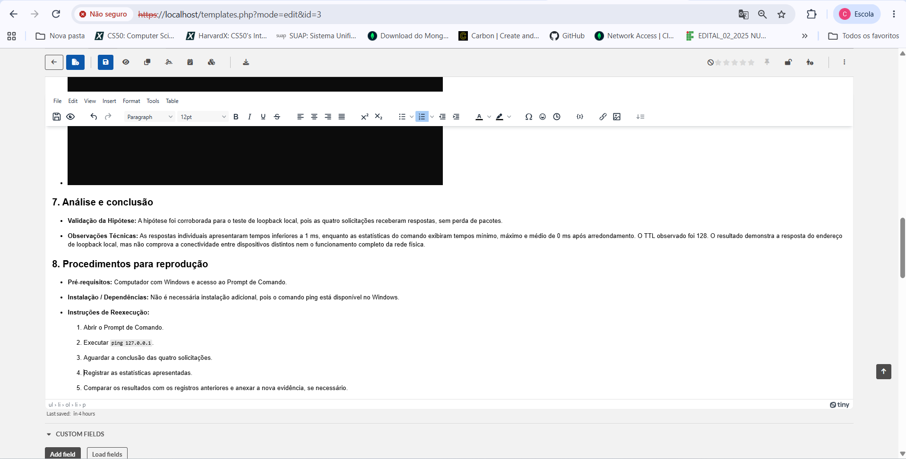
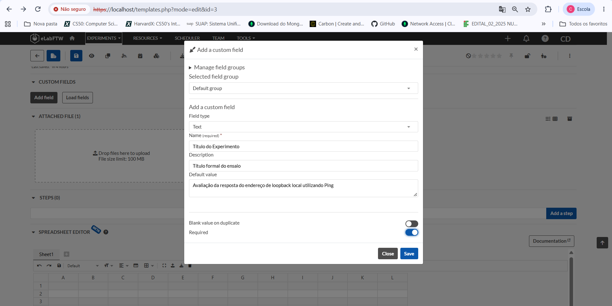
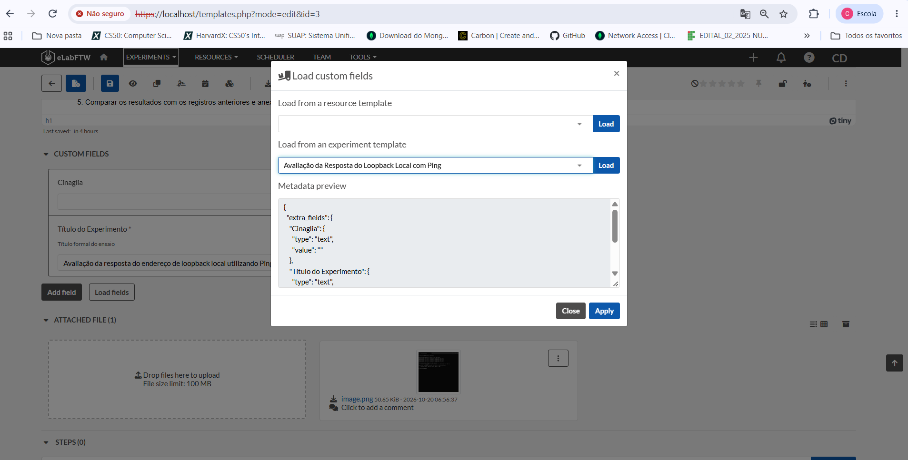
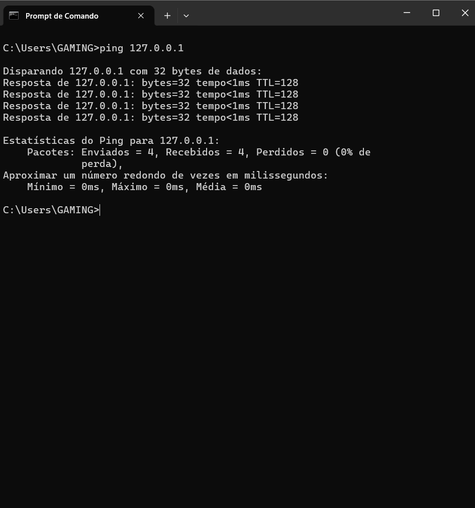
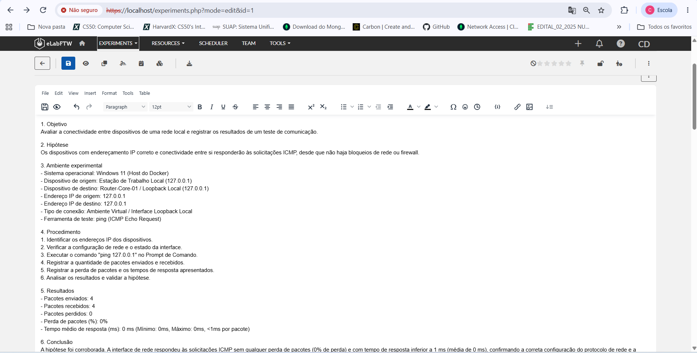

# Evidências e Documentação do eLabFTW - Testes de Rede

Esta pasta reúne a documentação, relatórios e artefatos de execução gerados no eLabFTW para os ensaios de conectividade e topologia de rede no âmbito do TCC.

---

## 📸 Evidências do Ambiente e Interface (eLabFTW)

### 1. Acesso e Autenticação no eLabFTW

*Figura 1: Tela de autenticação e acesso à instância local do eLabFTW.*

### 2. Painel Principal (Dashboard)

*Figura 2: Dashboard principal exibindo os experimentos registrados e o status das execuções.*

---

## ⚙️ Modelação do Template de Experimento

### 1. Criação do Modelo de Rede

*Figura 3: Formulário de criação de um novo registro/template de experimento no eLabFTW.*

### 2. Configuração dos Campos e Estrutura de 8 Pontos

*Figuras 4, 5 e 6: Definição da metodologia padronizada de 8 pontos para experimentos de Redes de Computadores no eLabFTW.*

### 3. Personalização e Importação de Campos (Custom Fields)

*Figuras 7 e 8: Configuração de meta-dados e reutilização de campos customizados JSON no eLabFTW.*

---

## 🧪 Execução do Experimento ICMP (Loopback Local)

### 1. Teste de Conectividade no Terminal (CMD)

*Figura 9: Execução do comando `ping 127.0.0.1` no Prompt de Comando, demonstrando 0% de perda de pacotes e tempo médio < 1 ms.*

### 2. Registro do Experimento e Anexos no eLabFTW

*Figuras 10, 11 e 12: Registro das métricas, visualização da topologia e anexo da planilha de dados no eLabFTW.*

---

## 📄 Artefatos e Documentos de Execução

* **`Avaliação da Resposta do Loopback.pdf`**: Relatório oficial exportado diretamente do eLabFTW com o hash SHA-256 e validação do ensaio.
* **`Dados do Teste.xlsx`**: Planilha de métricas contendo pacotes enviados (4), recebidos (4), perda (0%) e tempos de resposta.
* **`24-Cabo-de-Rede-UTP-REDE-LOCAL-LAN.json`**: Esquema de configuração estruturado do experimento.

---

## 📊 Resumo Executivo

* **Ferramenta:** `ping` (ICMP Echo Request)
* **Endereço de Origem e Destino:** `127.0.0.1`
* **Resultado:** 0% de perda de pacotes, tempo médio de 0 ms, TTL = 128.
* **Status:** Hipótese corroborada com sucesso.
