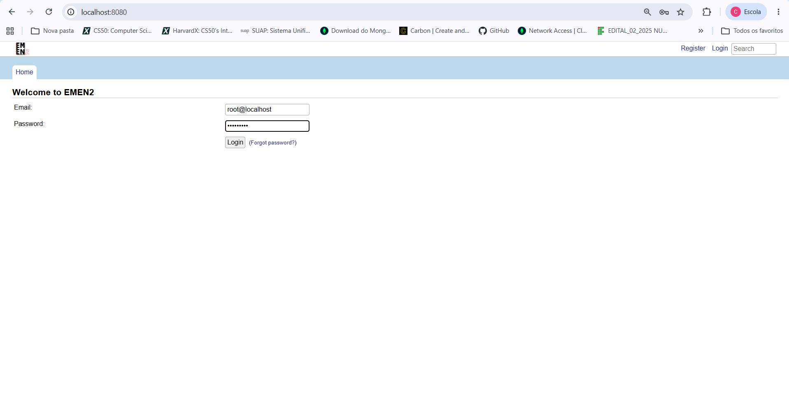
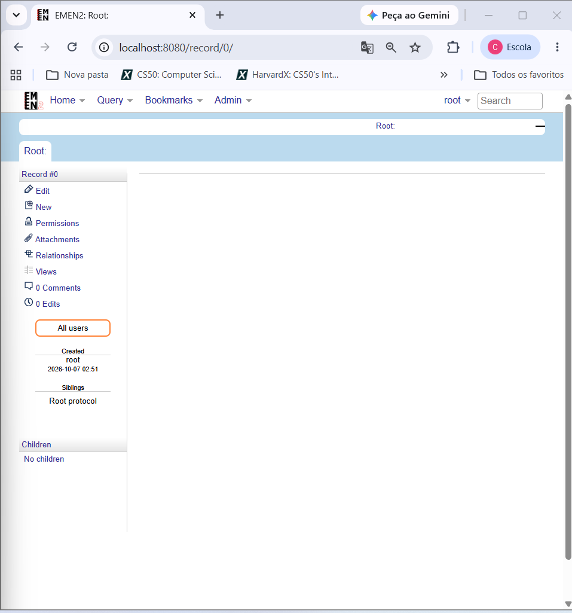
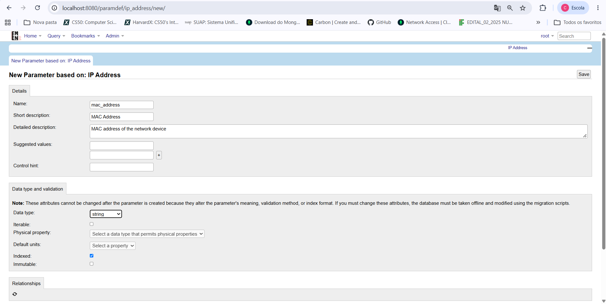
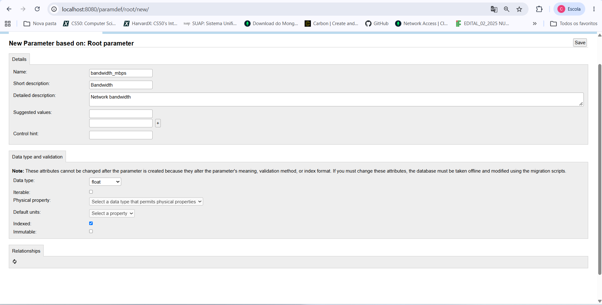
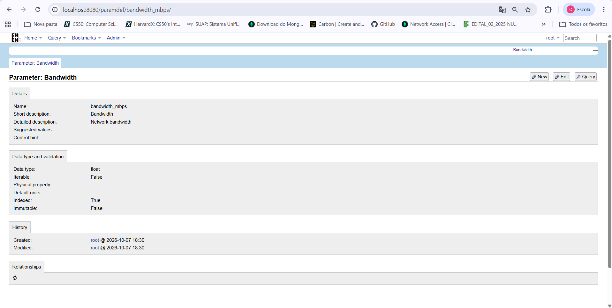
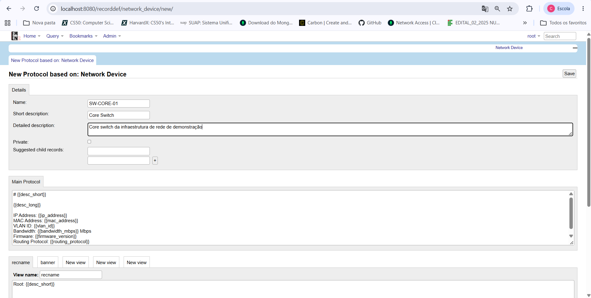
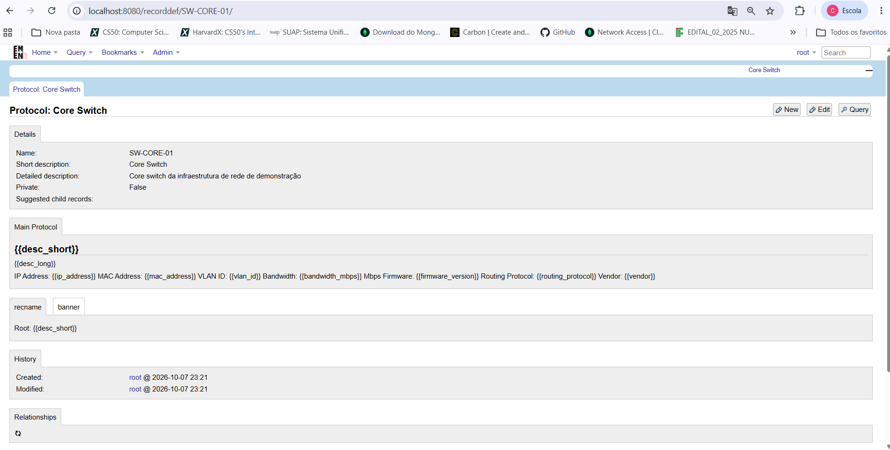
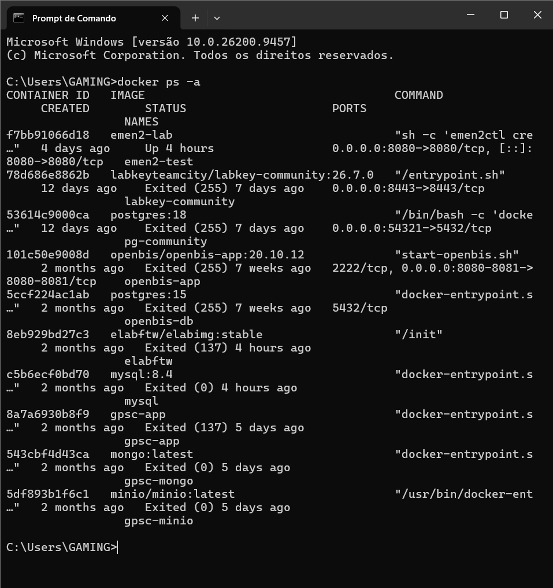
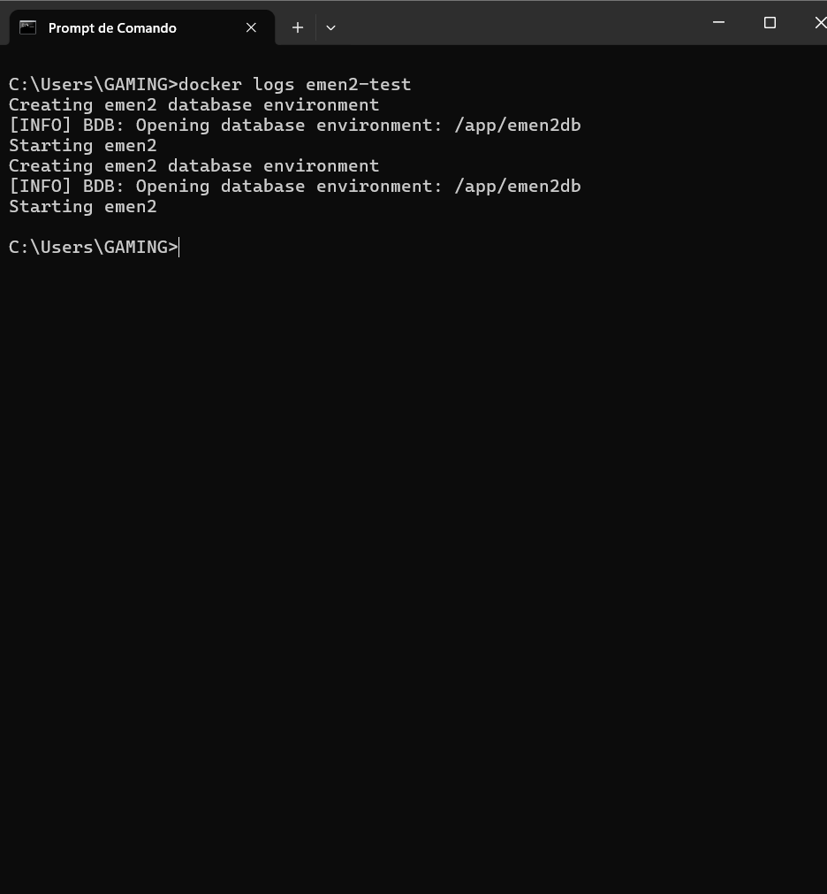
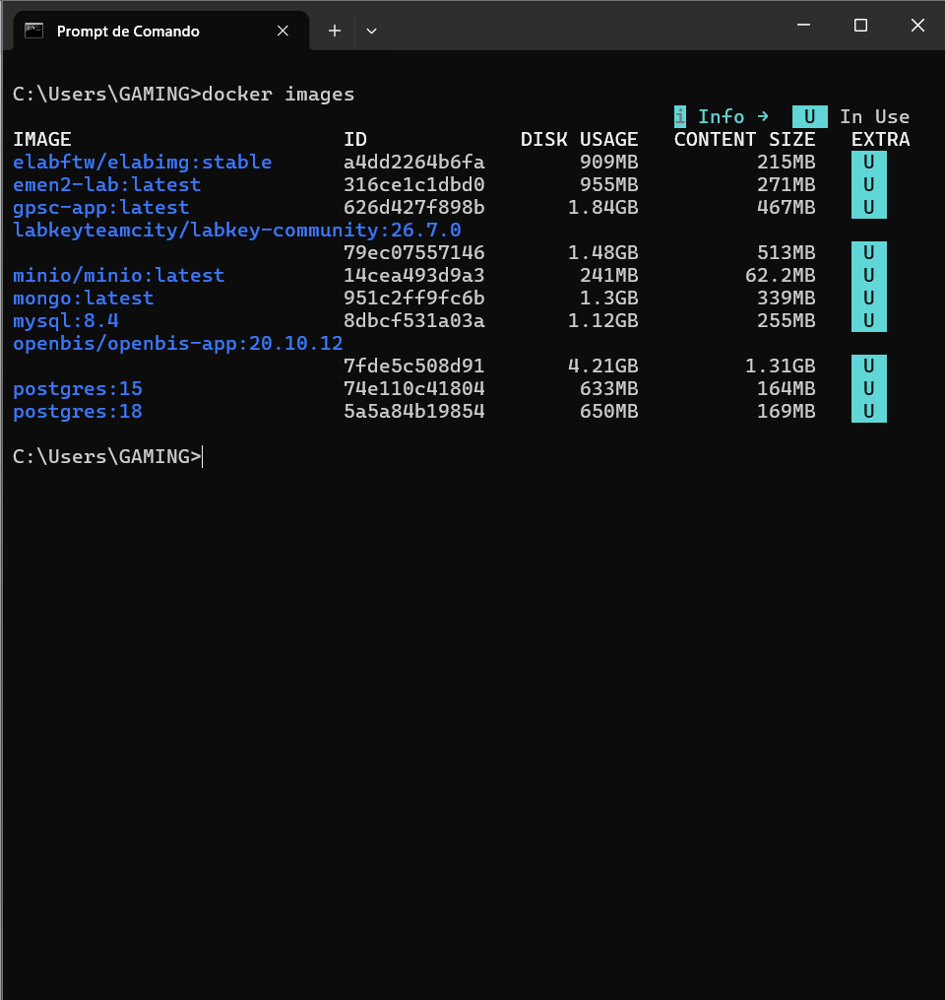

# Validação Experimental do EMEN2 para Gestão de Ativos de Rede (CMDB)

Este repositório documenta a avaliação prática e o processo de adaptação da plataforma **EMEN2** como ferramenta de inventário/CMDB no domínio de **Redes de Computadores**, desenvolvida no âmbito de uma Revisão Sistemática da Literatura (RSL).

---

## 1. Acesso e Estrutura Não-Instanciada (Nó Raiz)

Acedeu-se à instância local do EMEN2 a correr no ambiente Docker na porta `8080`. O sistema disponibiliza o nó de registo inicial `Record #0` (Root), a partir do qual toda a estrutura ontológica de ativos é construída hierarquicamente.

| Tela de Login | Nó Raiz Inicial (`/record/0/`) |
| :---: | :---: |
|  |  |

---

## 2. Ontologia e Modelação de Parâmetros (`ParamDef`)

Inspecionou-se a ontologia de parâmetros nativos do sistema (`/paramdefs/`) e procedeu-se à criação dos atributos específicos de ativos de rede.


### Cadastro dos Parâmetros de Camada 2 e 3

1. **IP Address (`ip_address`):**
   * Definição como tipo `string` indexado.
   * Confirmação da persistência no Berkeley DB (`/paramdef/ip_address/`).

| Formulário de Criação | Parâmetro Persistido |
| :---: | :---: |
|  |  |

2. **MAC Address (`mac_address`):**
   * Definição como tipo `string`.
   * Confirmação da persistência no banco de dados (`/paramdef/mac_address/`).

| Formulário de Criação | Parâmetro Persistido |
| :---: | :---: |
|  |  |

3. **Bandwidth (`bandwidth_mbps`):**
   * Definição como tipo `float` para medição de largura de banda em Mbps.
   * Confirmação da persistência (`/paramdef/bandwidth_mbps/`).

| Formulário de Criação | Parâmetro Persistido |
| :---: | :---: |
|  |  |

---

## 3. Definição e Ajuste do Tipo de Registro (`RecordDef`)

Criação da entidade base **`network_device`** (*Network Device*) derivada do protocolo raiz para agrupar os metadados.

### Limitação de GUI e Injeção de Template

A interface gráfica nativa ocultava a caixa de edição direta do template principal da *view*.

| View Inicial Limita GUI | Template Injetado na View |
| :---: | :---: |
|  |  |

Para contornar a limitação e associar os 7 parâmetros (`ip_address`, `mac_address`, `vlan_id`, `bandwidth_mbps`, `firmware_version`, `routing_protocol` e `vendor`), executou-se a injeção via script Python no contêiner:

```bash
docker exec -it emen2-test python -c "
import emen2.db.recorddef

rectype = emen2.db.recorddef.get('network_device')

template = '''# {{desc_short}}
{{desc_long}}

* IP Address: {{ip_address}}
* MAC Address: {{mac_address}}
* VLAN ID: {{vlan_id}}
* Bandwidth (Mbps): {{bandwidth_mbps}}
* Firmware Version: {{firmware_version}}
* Routing Protocol: {{routing_protocol}}
* Vendor: {{vendor}}'''

rectype['views']['main'] = template
emen2.db.recorddef.update(rectype)
print('RecordDef network_device atualizado com sucesso!')
"
---

## 4. Hierarquia de Ativos: Criação do Modelo `SW-CORE-01`

Para simular um ambiente CMDB real de infraestrutura de rede, derivou-se um tipo de registo específico para switches de núcleo de camada 3 (**`SW-CORE-01`**) a partir da definição base `network_device`.

### Parâmetros e Atributos Mapeados:
* **IP Address (`ip_address`):** Endereço IPv4 de gestão do dispositivo.
* **MAC Address (`mac_address`):** Endereço físico da interface principal.
* **VLAN ID (`vlan_id`):** Identificador da VLAN de gerência.
* **Bandwidth (`bandwidth_mbps`):** Capacidade de comutação / largura de banda em Mbps.
* **Firmware Version (`firmware_version`):** Versão do sistema operacional instalado no switch.
* **Routing Protocol (`routing_protocol`):** Protocolo de roteamento ativo (ex.: OSPF, BGP).
* **Vendor (`vendor`):** Fabricante do equipamento de rede.

| Formulário de Definição | Protocolo `SW-CORE-01` Salvo |
| :---: | :---: |
|  |  |

---

## 5. Conclusão da Análise para a RSL

A avaliação prática da plataforma **EMEN2** forneceu dados para compor a análise comparativa de ferramentas no âmbito da RSL:

1. **Capacidade de Adaptação (Extensibilidade):** **Alta.** O motor de dados do EMEN2 baseado em Berkeley DB e Python permite a criação e personalização de ontologias e novos tipos de dados sem necessidade de recompilação do sistema ou alteração do esquema de banco de dados tradicional.
2. **Usabilidade e Interface Web (DX / UX):** **Média/Baixa.** A interface gráfica nativa apresentou limitações para edição direta de templates de exibição (*views*), exigindo *workarounds* via linha de comando/scripts Python para injeção de atributos no backend.
3. **Adequação como CMDB de Redes:** **Viável com ressalvas.** O sistema atende aos requisitos de modelagem hierárquica e rastreabilidade de ativos, porém demanda um esforço considerável de configuração técnica inicial se comparado a soluções CMDB especializadas de mercado.

---

## 6. Preparação e execução do ambiente Docker

Esta seção descreve a preparação do ambiente Docker utilizado para executar o EMEN2, incluindo a construção da imagem, a inicialização do contêiner e a verificação dos registros de execução. O objetivo é documentar os procedimentos realizados e fornecer evidências que auxiliem na reprodução do experimento.

### 6.1. Construção da imagem Docker

Para executar o EMEN2 em um ambiente isolado, foi elaborado um `Dockerfile` contendo as instruções necessárias para instalar a aplicação e suas dependências.

A configuração utiliza Python 2.7, instala dependências do sistema operacional, obtém o código-fonte do EMEN2 a partir do repositório oficial e configura o Berkeley DB como mecanismo de armazenamento.

A construção da imagem foi realizada por meio do seguinte comando:

```bash
docker build -t emen2-lab .
```

A opção `-t` define o nome da imagem como `emen2-lab`. Após a construção, a imagem foi identificada como `emen2-lab:latest`.

### 6.2. Inicialização do contêiner

Após a construção da imagem, foi executado o seguinte comando para iniciar o contêiner:

```bash
docker run -d -p 8080:8080 --name emen2-test emen2-lab
```

Nesse comando, a opção `-d` executa o contêiner em segundo plano, `-p 8080:8080` publica a porta 8080 do contêiner na porta correspondente do host e `--name emen2-test` define o nome do contêiner.

Essa configuração permite acessar o serviço pela porta publicada, desde que a aplicação esteja efetivamente disponível nessa porta.

### 6.3. Verificação do estado do contêiner

Para verificar o estado dos contêineres, foi utilizado o comando:

```bash
docker ps -a
```

O resultado identificou o contêiner `emen2-test` com o estado `Up`, indicando que ele estava em execução no momento da verificação.

Essa observação confirma que o contêiner permaneceu ativo durante a consulta, mas não comprova, isoladamente, que todas as funcionalidades da aplicação estavam operacionais.

### 6.4. Verificação dos registros de execução

Os registros de execução foram consultados por meio do comando:

```bash
docker logs emen2-test
```

Os registros apresentaram mensagens relacionadas à criação do ambiente do banco de dados e à inicialização do EMEN2, incluindo:

```text
Creating emen2 database environment
[INFO] BDB: Opening database environment: /app/emen2db
Starting emen2
```

Essas mensagens constituem evidências de que o processo de inicialização foi executado e de que houve tentativa de abertura do ambiente do Berkeley DB.

### 6.5. Verificação da imagem construída

A imagem Docker foi consultada com o seguinte comando:

```bash
docker images
```

O resultado identificou a imagem `emen2-lab:latest`, cujo ID começava com `316ce1c1dbd0`. A imagem apresentou tamanho aproximado de 955 MB no ambiente utilizado.

Essa verificação confirma a presença da imagem construída no ambiente Docker.

### 6.6. Evidências experimentais
Para documentar os procedimentos e os resultados observados, foram registradas capturas de tela dos comandos executados e das respectivas saídas.

As evidências encontram-se salvas na raiz da pasta do experimento no repositório:

| Estado dos Contêineres | Registros do Log (`docker logs`) | Imagens Disponíveis |
| :---: | :---: | :---: |
|  |  |  |

### 6.7. Considerações sobre a reprodução do ambiente

A configuração utiliza Python 2.7 e dependências legadas. Por esse motivo, a reprodução do ambiente pode depender da disponibilidade dos repositórios de pacotes, da compatibilidade entre as dependências e das condições do sistema utilizado.

Os resultados documentados nesta seção demonstram a construção da imagem Docker, a presença do contêiner em execução no momento da consulta e a geração de registros relacionados à inicialização do EMEN2. Entretanto, essas evidências não são suficientes, isoladamente, para comprovar o funcionamento integral da aplicação.

A avaliação funcional do EMEN2 deve ser analisada em conjunto com os procedimentos, critérios e resultados apresentados nas seções anteriores deste README.
