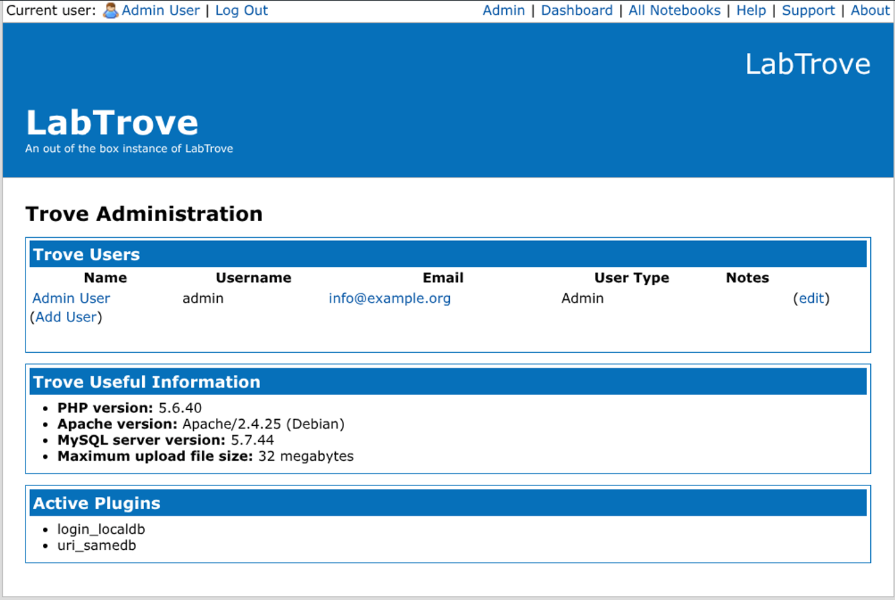
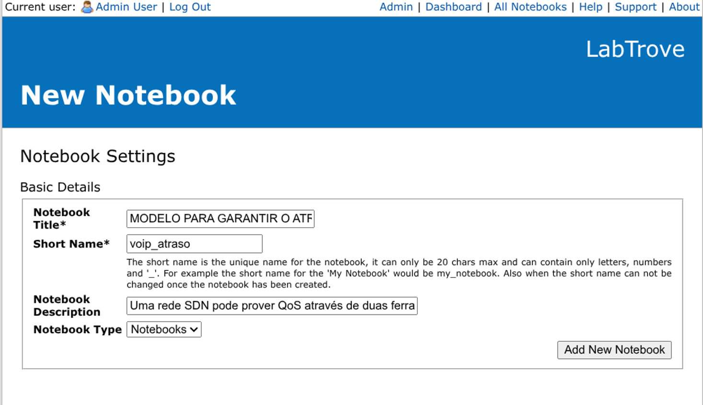
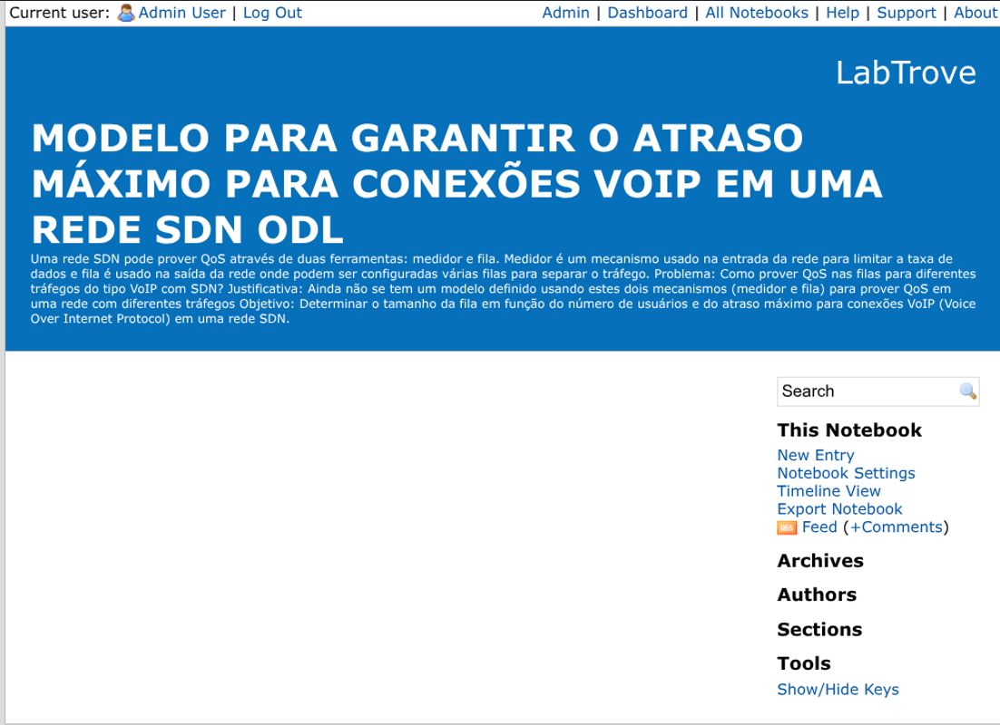
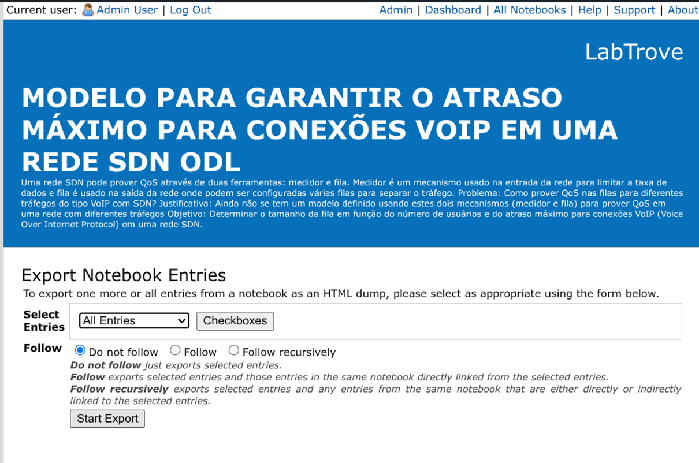

# Evidências e Adaptação do LabTrove — Testes de Rede

Esta pasta reúne a documentação, os arquivos de configuração e as capturas de tela da adaptação do ELN **LabTrove (v2.4)** para o registro e a documentação de experimentos de Redes de Computadores, no contexto do Trabalho de Conclusão de Curso (TCC).

## 1. Implantação e Provisionamento com Docker Compose

O ambiente do LabTrove foi implantado em contêineres Docker, utilizando uma imagem da aplicação conectada a uma instância do banco de dados MySQL 5.7. A configuração utilizada está representada no arquivo Docker Compose a seguir.

```yaml
version: '3.8'

services:
  web:
    image: re2jppa/labtrove:latest
    container_name: labtrove_app
    ports:
      - "8080:80"
    environment:
      - DB_HOST=db
    depends_on:
      - db
    restart: always

  db:
    image: mysql:5.7
    container_name: labtrove_db
    ports:
      - "3306:3306"
    environment:
      MYSQL_ROOT_PASSWORD: rootpassword
      MYSQL_DATABASE: labtrove
      MYSQL_USER: labtrove
      MYSQL_PASSWORD: labtrove
    volumes:
      - db_data:/var/lib/mysql
    restart: always

volumes:
  db_data:
```

## 2. Características e Limitações da Plataforma

- **Estrutura baseada em blog:** organiza os registros em entradas cronológicas associadas a cadernos de laboratório (*notebooks*), permitindo documentar as etapas dos experimentos.
- **Autenticação:** oferece suporte a mecanismos de autenticação configuráveis por meio do arquivo `config.php`, conforme os plugins disponíveis na instalação.
- **Gestão de visibilidade:** permite configurar níveis de visibilidade dos notebooks, incluindo acesso público, para usuários autenticados, privado ou por zona, conforme as opções disponibilizadas pela plataforma.
- **Colaboração:** permite adicionar comentários às postagens e consultar os registros em uma linha do tempo (*Timeline*).
- **Exportação:** oferece recursos para exportar notebooks e baixar os dados gerados em arquivos compactados, conforme demonstrado nas evidências.
- **Limitação de integração:** não foi identificada integração nativa com o Jupyter Notebook durante os testes realizados.

## 3. Evidências do Ambiente e Funcionalidades

### 3.1. Autenticação e Gestão Administrativa


*Figura 1 — Tela inicial e formulário de autenticação do LabTrove.*



*Figura 2 — Painel administrativo com informações sobre os usuários cadastrados e as configurações disponíveis no ambiente.*

---

### 3.2. Criação, Configuração e Estrutura do Notebook



*Figura 3 — Formulário de criação de um notebook destinado ao registro do experimento sobre garantia de atraso máximo para conexões VoIP em uma rede SDN.*


*Figura 4 — Opções de configuração de visibilidade e níveis de acesso ao notebook.*



*Figura 5 — Interface do notebook recém-criado, antes da inclusão de registros experimentais.*

---

### 3.3. Registro do Experimento, Postagens e Colaboração


*Figura 6 — Interface principal exibindo o notebook cadastrado para o experimento.*


*Figura 7 — Editor de postagem utilizado para registrar informações sobre a metodologia, os parâmetros do ambiente experimental e a topologia de rede.*


*Figura 8 — Visualização do notebook com a primeira entrada referente à metodologia do experimento.*


<p align="center"><em>Figura 9 — Caderno de laboratório com os registros do experimento organizados nas seções de Metodologia, Cenários de Teste e Resultados.</em></p>


*Figura 10 — Painel principal com as postagens recentes relacionadas ao experimento.*


*Figura 11 — Seção de comentários de uma postagem, demonstrando o recurso de colaboração entre participantes.*


*Figura 12 — Visualização em linha do tempo (*Timeline*), organizando cronologicamente as postagens do experimento.*

---

### 3.4. Exportação e Download dos Dados



*Figura 13 — Interface de exportação das entradas do notebook, com as opções de exportação disponíveis.*


*Figura 14 — Interface de confirmação da exportação e disponibilização do arquivo compactado para download.*

---

## 4. Resumo do Experimento Registrado

- **Experimento:** modelo para garantir o atraso máximo de conexões VoIP em uma rede SDN com OpenDaylight (ODL).
- **Ferramentas de emulação e experimentação:** Mininet, OpenDaylight (ODL) e D-ITG.
- **Registros documentados:**
  - **Metodologia:** descrição do procedimento experimental e dos parâmetros considerados, incluindo taxa de dados, tamanho do buffer e quantidade de hosts.
  - **Cenários de teste:** documentação dos cenários de tráfego VoIP e das configurações de filas de prioridade.
  - **Resultados:** registro das medições obtidas no ambiente emulado.
- **Documentação e exportação:** registros organizados no notebook e exportação dos dados conforme demonstrado nas evidências.

## 5. Considerações Finais

Os testes demonstraram que o LabTrove pode ser utilizado para organizar e documentar informações de experimentos de Redes de Computadores por meio de notebooks, postagens cronológicas, comentários e recursos de exportação.

A adaptação aproveita a estrutura flexível de registros da plataforma para documentar metodologia, cenários de teste e resultados experimentais. Entretanto, a documentação desses elementos não implica execução automática das simulações pela ferramenta. Também não foi identificada integração nativa com o Jupyter Notebook durante os testes.

As evidências apresentadas registram as funcionalidades exploradas e a organização dos dados do experimento no ambiente LabTrove.


